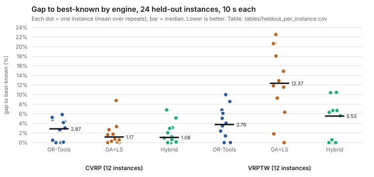

# LogiMind evaluation (P10)

Generated 2026-11-05 08:32 UTC by `experiments/p10_report.py` from **stored runs only**. Every number below comes from the committed
files under `experiments/results/`; nothing was typed in by hand. Machine for all runs: Rohit's laptop
(AMD64 Family 23 Model 96 Stepping 1, AuthenticAMD, 16 logical CPUs),
Python 3.14.7, OR-Tools 9.15.6755.
Tables are also in `docs/report/tables/` (CSV); figures in `docs/report/figures/` (SVG).

## 1. Solver quality on 24 held-out benchmark instances

### 1.1 Set-up
- **Why a held-out set:** all 10 instances of the P3 comparison were also used in the P2 OR-Tools audit, which chose
  OR-Tools' default settings, so results on them favour OR-Tools. These 24 instances were **not used for any
  tuning** (decision 0022):

| instance_name | problem | customers | vehicles | best_known |
| --- | --- | --- | --- | --- |
| A-n33-k5 | CVRP | 32 | 5 | 661.00 |
| A-n37-k5 | CVRP | 36 | 5 | 669.00 |
| A-n39-k6 | CVRP | 38 | 6 | 831.00 |
| A-n45-k6 | CVRP | 44 | 6 | 944.00 |
| A-n48-k7 | CVRP | 47 | 7 | 1073.00 |
| A-n53-k7 | CVRP | 52 | 7 | 1010.00 |
| A-n55-k9 | CVRP | 54 | 9 | 1073.00 |
| A-n63-k10 | CVRP | 62 | 10 | 1314.00 |
| A-n69-k9 | CVRP | 68 | 9 | 1159.00 |
| X-n106-k14 | CVRP | 105 | 105 | 26362.00 |
| X-n110-k13 | CVRP | 109 | 109 | 14971.00 |
| X-n120-k6 | CVRP | 119 | 119 | 13332.00 |
| C102 | VRPTW | 100 | 25 | 827.30 |
| C105 | VRPTW | 100 | 25 | 827.30 |
| C202 | VRPTW | 100 | 25 | 589.10 |
| C205 | VRPTW | 100 | 25 | 586.40 |
| R102 | VRPTW | 100 | 25 | 1466.60 |
| R105 | VRPTW | 100 | 25 | 1355.30 |
| R110 | VRPTW | 100 | 25 | 1068.00 |
| R202 | VRPTW | 100 | 25 | 1029.60 |
| RC102 | VRPTW | 100 | 25 | 1457.40 |
| RC105 | VRPTW | 100 | 25 | 1513.70 |
| RC202 | VRPTW | 100 | 25 | 1092.30 |
| RC205 | VRPTW | 100 | 25 | 1154.00 |

- **Rules:** same instance, same distance matrix, same objective, same **total** wall-clock budget per run
  (the hybrid's OR-Tools phase is inside it), one run at a time through the wall-clock guard, 3 repeats
  (OR-Tools has no seed, so its repeats are re-runs). Gaps are to the published best-known values in
  `experiments/benchmarks/bks.csv` (CVRPLIB, source URL and date in that file).
  Budgets: 3 s, 10 s.
- **Engines:** the three the platform serves: OR-Tools (audited defaults), GA + local search, and the hybrid
  (OR-Tools for half the budget, then GA + local search seeded with its tour).
- **Significance:** per instance, the mean gap over feasible repeats; a two-sided Wilcoxon signed-rank test per
  engine pair, for all instances and per problem type; Holm correction over the 9 tests **of each budget**. A
  difference of at most 0.01 percentage points is a tie. An instance where an engine had no feasible run is left out of
  that pair (`dropped` in the CSV).

### 1.2 Held-out set at 3 s
216 runs; estimate 11 min; run started 2026-11-05T06:44:45+00:00.

| problem | budget_s | engine | instances | customers | feasible | runs with violations | gap mean / median % | gap IQR % | gap range % | repeat SD (median, pp) | runtime mean / max s |
| --- | --- | --- | --- | --- | --- | --- | --- | --- | --- | --- | --- |
| CVRP | 3.0 | GA + local search | 12 | 32-119 | 35 / 36 | 1 | 2.84 / 2.24 | 0.47 to 3.96 | 0.00 to 11.10 | 0.53 | 3.00 / 3.00 |
| CVRP | 3.0 | Hybrid (OR-Tools seed + GA + LS) | 12 | 32-119 | 36 / 36 | 0 | 3.53 / 2.42 | 1.20 to 5.89 | 0.00 to 12.39 | 0.60 | 3.00 / 3.00 |
| CVRP | 3.0 | OR-Tools | 12 | 32-119 | 36 / 36 | 0 | 4.88 / 3.68 | 2.24 to 7.11 | 0.00 to 14.05 | 0.00 | 3.00 / 3.00 |
| VRPTW | 3.0 | GA + local search | 12 | 100-100 | 36 / 36 | 0 | 15.74 / 15.11 | 10.34 to 23.23 | 0.00 to 28.40 | 1.45 | 3.00 / 3.01 |
| VRPTW | 3.0 | Hybrid (OR-Tools seed + GA + LS) | 12 | 100-100 | 36 / 36 | 0 | 4.66 / 5.75 | 0.00 to 7.29 | 0.00 to 13.22 | 0.00 | 3.01 / 3.01 |
| VRPTW | 3.0 | OR-Tools | 12 | 100-100 | 36 / 36 | 0 | 4.51 / 5.75 | 0.00 to 7.03 | 0.00 to 10.52 | 0.00 | 3.00 / 3.01 |

| set | scope | comparison (B minus A) | instances | median / mean diff (pp) | B better / tie / A better | Wilcoxon p | Holm-adjusted p |
| --- | --- | --- | --- | --- | --- | --- | --- |
| held-out, 3 s | all | GA + local search minus OR-Tools | 24 | 1.20 / 4.64 | 10 / 1 / 13 | 0.0680 | 0.2040 |
| held-out, 3 s | all | Hybrid (OR-Tools seed + GA + LS) minus OR-Tools | 24 | 0.00 / -0.60 | 10 / 10 / 4 | 0.0480 | 0.1920 |
| held-out, 3 s | all | Hybrid (OR-Tools seed + GA + LS) minus GA + local search | 24 | -0.79 / -5.24 | 14 / 1 / 9 | 0.0225 | 0.1127 |
| held-out, 3 s | CVRP | GA + local search minus OR-Tools | 12 | -1.70 / -1.96 | 10 / 1 / 1 | 0.0068 | 0.0479 |
| held-out, 3 s | CVRP | Hybrid (OR-Tools seed + GA + LS) minus OR-Tools | 12 | -1.20 / -1.35 | 9 / 2 / 1 | 0.0137 | 0.0820 |
| held-out, 3 s | CVRP | Hybrid (OR-Tools seed + GA + LS) minus GA + local search | 12 | 0.39 / 0.61 | 3 / 1 / 8 | 0.1475 | 0.2949 |
| held-out, 3 s | VRPTW | GA + local search minus OR-Tools | 12 | 8.20 / 11.23 | 0 / 0 / 12 | 0.0005 | 0.0044 |
| held-out, 3 s | VRPTW | Hybrid (OR-Tools seed + GA + LS) minus OR-Tools | 12 | 0.00 / 0.15 | 1 / 8 / 3 | 0.6250 | 0.6250 |
| held-out, 3 s | VRPTW | Hybrid (OR-Tools seed + GA + LS) minus GA + local search | 12 | -8.03 / -11.08 | 11 / 0 / 1 | 0.0010 | 0.0078 |

**Reading ("difference" = first-named engine minus OR-Tools or GA; negative = the first-named engine's gap is
smaller):**
- **CVRP, GA + LS vs OR-Tools:** GA + local search better on 10, tie 1, OR-Tools better on 1 of 12 instances; median difference -1.70 pp; Holm-adjusted p = 0.0479.
- **CVRP, hybrid vs OR-Tools:** Hybrid (OR-Tools seed + GA + LS) better on 9, tie 2, OR-Tools better on 1 of 12 instances; median difference -1.20 pp; Holm-adjusted p = 0.0820.
- **VRPTW, GA + LS vs OR-Tools:** GA + local search better on 0, tie 0, OR-Tools better on 12 of 12 instances; median difference 8.20 pp; Holm-adjusted p = 0.0044.
- **VRPTW, hybrid vs OR-Tools:** Hybrid (OR-Tools seed + GA + LS) better on 1, tie 8, OR-Tools better on 3 of 12 instances; median difference 0.00 pp; Holm-adjusted p = 0.6250.
- **All 24, hybrid vs OR-Tools:** Hybrid (OR-Tools seed + GA + LS) better on 10, tie 10, OR-Tools better on 4 of 24 instances; median difference 0.00 pp; Holm-adjusted p = 0.1920.
- Significant after the Holm correction (p < 0.05):
  - CVRP: GA + local search minus OR-Tools (Holm-adjusted p = 0.0479, median difference -1.70 pp)
  - VRPTW: GA + local search minus OR-Tools (Holm-adjusted p = 0.0044, median difference 8.20 pp)
  - VRPTW: Hybrid (OR-Tools seed + GA + LS) minus GA + local search (Holm-adjusted p = 0.0078, median difference -8.03 pp)

### 1.3 Held-out set at 10 s
**PARTIAL: 134 of 216 planned runs stored** (1 left out as timing anomalies, section 1.7). The run was stopped by the session because the laptop ran low on memory (decision 0024); it was not restarted. Every instance has 1 to 2 repeats per engine instead of 3. Treat these results as preliminary. Run started 2026-11-05T07:22:25+00:00.

| problem | budget_s | engine | instances | customers | feasible | runs with violations | gap mean / median % | gap IQR % | gap range % | repeat SD (median, pp) | runtime mean / max s |
| --- | --- | --- | --- | --- | --- | --- | --- | --- | --- | --- | --- |
| CVRP | 10.0 | GA + local search | 12 | 32-119 | 20 / 20 | 0 | 1.42 / 0.69 | 0.07 to 2.35 | 0.00 to 8.78 | 0.12 | 10.00 / 10.00 |
| CVRP | 10.0 | Hybrid (OR-Tools seed + GA + LS) | 12 | 32-119 | 20 / 20 | 0 | 1.68 / 0.87 | 0.18 to 2.26 | 0.00 to 7.42 | 0.04 | 10.00 / 10.00 |
| CVRP | 10.0 | OR-Tools | 12 | 32-119 | 21 / 21 | 0 | 2.59 / 2.67 | 0.09 to 4.36 | 0.00 to 5.86 | 0.00 | 10.00 / 10.01 |
| VRPTW | 10.0 | GA + local search | 12 | 100-100 | 24 / 24 | 0 | 12.55 / 12.14 | 8.48 to 18.44 | 0.00 to 23.02 | 0.59 | 10.00 / 10.01 |
| VRPTW | 10.0 | Hybrid (OR-Tools seed + GA + LS) | 12 | 100-100 | 24 / 24 | 0 | 4.35 / 5.53 | 0.00 to 6.71 | 0.00 to 10.52 | 0.00 | 10.01 / 10.01 |
| VRPTW | 10.0 | OR-Tools | 12 | 100-100 | 24 / 24 | 0 | 3.99 / 3.76 | 1.05 to 6.27 | 0.00 to 10.01 | 0.00 | 10.00 / 10.01 |

| set | scope | comparison (B minus A) | instances | median / mean diff (pp) | B better / tie / A better | Wilcoxon p | Holm-adjusted p |
| --- | --- | --- | --- | --- | --- | --- | --- |
| held-out, 10 s | all | GA + local search minus OR-Tools | 24 | 0.23 / 3.82 | 9 / 3 / 12 | 0.0537 | 0.3223 |
| held-out, 10 s | all | Hybrid (OR-Tools seed + GA + LS) minus OR-Tools | 24 | 0.00 / -0.22 | 10 / 5 / 9 | 0.3760 | 1.0000 |
| held-out, 10 s | all | Hybrid (OR-Tools seed + GA + LS) minus GA + local search | 24 | -0.54 / -4.05 | 13 / 4 / 7 | 0.0100 | 0.0700 |
| held-out, 10 s | CVRP | GA + local search minus OR-Tools | 12 | -0.61 / -0.92 | 8 / 2 / 2 | 0.1055 | 0.5273 |
| held-out, 10 s | CVRP | Hybrid (OR-Tools seed + GA + LS) minus OR-Tools | 12 | -0.18 / -0.81 | 6 / 2 / 4 | 0.1602 | 0.6406 |
| held-out, 10 s | CVRP | Hybrid (OR-Tools seed + GA + LS) minus GA + local search | 12 | 0.02 / 0.11 | 3 / 3 / 6 | 0.7344 | 1.0000 |
| held-out, 10 s | VRPTW | GA + local search minus OR-Tools | 12 | 5.93 / 8.56 | 1 / 1 / 10 | 0.0020 | 0.0176 |
| held-out, 10 s | VRPTW | Hybrid (OR-Tools seed + GA + LS) minus OR-Tools | 12 | 0.00 / 0.36 | 4 / 3 / 5 | 0.9102 | 1.0000 |
| held-out, 10 s | VRPTW | Hybrid (OR-Tools seed + GA + LS) minus GA + local search | 12 | -5.98 / -8.20 | 10 / 1 / 1 | 0.0020 | 0.0176 |

**Reading ("difference" = first-named engine minus OR-Tools or GA; negative = the first-named engine's gap is
smaller):**
- **CVRP, GA + LS vs OR-Tools:** GA + local search better on 8, tie 2, OR-Tools better on 2 of 12 instances; median difference -0.61 pp; Holm-adjusted p = 0.5273.
- **CVRP, hybrid vs OR-Tools:** Hybrid (OR-Tools seed + GA + LS) better on 6, tie 2, OR-Tools better on 4 of 12 instances; median difference -0.18 pp; Holm-adjusted p = 0.6406.
- **VRPTW, GA + LS vs OR-Tools:** GA + local search better on 1, tie 1, OR-Tools better on 10 of 12 instances; median difference 5.93 pp; Holm-adjusted p = 0.0176.
- **VRPTW, hybrid vs OR-Tools:** Hybrid (OR-Tools seed + GA + LS) better on 4, tie 3, OR-Tools better on 5 of 12 instances; median difference 0.00 pp; Holm-adjusted p = 1.0000.
- **All 24, hybrid vs OR-Tools:** Hybrid (OR-Tools seed + GA + LS) better on 10, tie 5, OR-Tools better on 9 of 24 instances; median difference 0.00 pp; Holm-adjusted p = 1.0000.
- Significant after the Holm correction (p < 0.05):
  - VRPTW: GA + local search minus OR-Tools (Holm-adjusted p = 0.0176, median difference 5.93 pp)
  - VRPTW: Hybrid (OR-Tools seed + GA + LS) minus GA + local search (Holm-adjusted p = 0.0176, median difference -5.98 pp)

### 1.4 Do the 3 s findings hold at 10 s?
Each cell: first engine better / tie / OR-Tools better (instances), median difference, Holm-adjusted p. The verdict
is computed from these numbers (significant = Holm-adjusted p < 0.05).

**The 10 s column is PRELIMINARY** (partial run, see 1.3): fewer repeats per instance, so these verdicts may change when the run is completed.

| comparison (first engine better / tie / OR-Tools better) | 3 s | 10 s | verdict |
| --- | --- | --- | --- |
| CVRP: GA + LS vs OR-Tools | 10 / 1 / 1; median -1.70 pp; p = 0.0479 | 8 / 2 / 2; median -0.61 pp; p = 0.5273 | same direction, but not significant at 10 s |
| VRPTW: GA + LS vs OR-Tools | 0 / 0 / 12; median 8.20 pp; p = 0.0044 | 1 / 1 / 10; median 5.93 pp; p = 0.0176 | holds (significant at both budgets) |
| CVRP: hybrid vs OR-Tools | 9 / 2 / 1; median -1.20 pp; p = 0.0820 | 6 / 2 / 4; median -0.18 pp; p = 0.6406 | not significant at either budget |
| VRPTW: hybrid vs OR-Tools | 1 / 8 / 3; median 0.00 pp; p = 0.6250 | 4 / 3 / 5; median 0.00 pp; p = 1.0000 | not significant at either budget |
| All 24: hybrid vs OR-Tools | 10 / 10 / 4; median 0.00 pp; p = 0.1920 | 10 / 5 / 9; median 0.00 pp; p = 1.0000 | not significant at either budget |

### 1.5 P3 comparison set (stored, 2 Nov 2026; tuning overlap)
The same three engines from the stored P3 runs (8 benchmark instances with a best-known value, 2 seeds, 3 s and
10 s). **These instances overlap the OR-Tools tuning set (P2 audit)**, so this table is biased towards OR-Tools
and is shown for completeness only.

| problem | budget_s | engine | instances | customers | feasible | runs with violations | gap mean / median % | gap IQR % | gap range % | repeat SD (median, pp) | runtime mean / max s |
| --- | --- | --- | --- | --- | --- | --- | --- | --- | --- | --- | --- |
| CVRP | 3.0 | GA + local search | 3 | 31-100 | 6 / 6 | 0 | 3.58 / 4.95 | 1.19 to 5.58 | 0.00 to 5.84 | 0.08 | 3.00 / 3.00 |
| CVRP | 3.0 | Hybrid (OR-Tools seed + GA + LS) | 3 | 31-100 | 6 / 6 | 0 | 3.46 / 4.92 | 1.19 to 5.31 | 0.00 to 5.53 | 0.32 | 3.00 / 3.00 |
| CVRP | 3.0 | OR-Tools | 3 | 31-100 | 6 / 6 | 0 | 3.88 / 5.79 | 1.45 to 5.83 | 0.00 to 5.85 | 0.00 | 3.00 / 3.00 |
| CVRP | 10.0 | GA + local search | 3 | 31-100 | 6 / 6 | 0 | 2.26 / 3.01 | 0.69 to 3.29 | 0.00 to 4.25 | 0.32 | 10.00 / 10.00 |
| CVRP | 10.0 | Hybrid (OR-Tools seed + GA + LS) | 3 | 31-100 | 6 / 6 | 0 | 2.44 / 3.18 | 0.61 to 4.06 | 0.00 to 4.16 | 0.04 | 10.00 / 10.00 |
| CVRP | 10.0 | OR-Tools | 3 | 31-100 | 6 / 6 | 0 | 3.07 / 3.52 | 0.88 to 5.14 | 0.00 to 5.68 | 0.00 | 10.00 / 10.00 |
| VRPTW | 3.0 | GA + local search | 5 | 100-100 | 10 / 10 | 0 | 13.89 / 12.53 | 6.69 to 21.89 | 0.00 to 26.80 | 1.41 | 3.00 / 3.01 |
| VRPTW | 3.0 | Hybrid (OR-Tools seed + GA + LS) | 5 | 100-100 | 10 / 10 | 0 | 3.54 / 3.33 | 2.91 to 4.78 | 0.00 to 6.67 | 0.00 | 3.01 / 3.01 |
| VRPTW | 3.0 | OR-Tools | 5 | 100-100 | 10 / 10 | 0 | 3.15 / 2.91 | 2.82 to 3.33 | 0.00 to 6.67 | 0.00 | 3.00 / 3.00 |
| VRPTW | 10.0 | GA + local search | 5 | 100-100 | 10 / 10 | 0 | 11.67 / 8.93 | 5.62 to 19.55 | 0.00 to 24.70 | 0.53 | 10.00 / 10.01 |
| VRPTW | 10.0 | Hybrid (OR-Tools seed + GA + LS) | 5 | 100-100 | 10 / 10 | 0 | 2.88 / 2.82 | 2.09 to 3.33 | 0.00 to 6.52 | 0.00 | 10.01 / 10.01 |
| VRPTW | 10.0 | OR-Tools | 5 | 100-100 | 10 / 10 | 0 | 2.61 / 2.72 | 2.52 to 3.74 | 0.00 to 4.26 | 0.00 | 10.00 / 10.00 |

| set | scope | comparison (B minus A) | instances | median / mean diff (pp) | B better / tie / A better | Wilcoxon p | Holm-adjusted p |
| --- | --- | --- | --- | --- | --- | --- | --- |
| P3 set, 3 s | all | GA + local search minus OR-Tools | 8 | 3.05 / 6.60 | 1 / 2 / 5 | 0.0625 | 0.5000 |
| P3 set, 3 s | all | Hybrid (OR-Tools seed + GA + LS) minus OR-Tools | 8 | 0.00 / 0.09 | 2 / 5 / 1 | 1.0000 | 1.0000 |
| P3 set, 3 s | all | Hybrid (OR-Tools seed + GA + LS) minus GA + local search | 8 | -3.05 / -6.52 | 6 / 1 / 1 | 0.0312 | 0.2812 |
| P3 set, 3 s | CVRP | GA + local search minus OR-Tools | 3 | 0.00 / -0.30 | 1 / 2 / 0 | 1.0000 | 1.0000 |
| P3 set, 3 s | CVRP | Hybrid (OR-Tools seed + GA + LS) minus OR-Tools | 3 | -0.55 / -0.42 | 2 / 1 / 0 | 0.5000 | 1.0000 |
| P3 set, 3 s | CVRP | Hybrid (OR-Tools seed + GA + LS) minus GA + local search | 3 | 0.00 / -0.12 | 1 / 1 / 1 | 1.0000 | 1.0000 |
| P3 set, 3 s | VRPTW | GA + local search minus OR-Tools | 5 | 9.19 / 10.74 | 0 / 0 / 5 | 0.0625 | 0.5000 |
| P3 set, 3 s | VRPTW | Hybrid (OR-Tools seed + GA + LS) minus OR-Tools | 5 | 0.00 / 0.39 | 0 / 4 / 1 | 1.0000 | 1.0000 |
| P3 set, 3 s | VRPTW | Hybrid (OR-Tools seed + GA + LS) minus GA + local search | 5 | -9.19 / -10.35 | 5 / 0 / 0 | 0.0625 | 0.5000 |
| P3 set, 10 s | all | GA + local search minus OR-Tools | 8 | 1.64 / 5.36 | 2 / 2 / 4 | 0.1562 | 1.0000 |
| P3 set, 10 s | all | Hybrid (OR-Tools seed + GA + LS) minus OR-Tools | 8 | -0.17 / -0.07 | 4 / 2 / 2 | 0.8438 | 1.0000 |
| P3 set, 10 s | all | Hybrid (OR-Tools seed + GA + LS) minus GA + local search | 8 | -1.83 / -5.43 | 4 / 2 / 2 | 0.1562 | 1.0000 |
| P3 set, 10 s | CVRP | GA + local search minus OR-Tools | 3 | -0.51 / -0.81 | 2 / 1 / 0 | 0.5000 | 1.0000 |
| P3 set, 10 s | CVRP | Hybrid (OR-Tools seed + GA + LS) minus OR-Tools | 3 | -0.34 / -0.63 | 2 / 1 / 0 | 0.5000 | 1.0000 |
| P3 set, 10 s | CVRP | Hybrid (OR-Tools seed + GA + LS) minus GA + local search | 3 | 0.17 / 0.18 | 0 / 1 / 2 | 0.5000 | 1.0000 |
| P3 set, 10 s | VRPTW | GA + local search minus OR-Tools | 5 | 6.20 / 9.06 | 0 / 1 / 4 | 0.1250 | 1.0000 |
| P3 set, 10 s | VRPTW | Hybrid (OR-Tools seed + GA + LS) minus OR-Tools | 5 | 0.00 / 0.27 | 2 / 1 / 2 | 0.8750 | 1.0000 |
| P3 set, 10 s | VRPTW | Hybrid (OR-Tools seed + GA + LS) minus GA + local search | 5 | -5.59 / -8.79 | 4 / 1 / 0 | 0.1250 | 1.0000 |

### 1.6 Constraint violations
The validator checks every returned plan. "Runs with violations" counts runs with any capacity, time-window,
unserved-customer or other violation (for example more routes than vehicles); such a plan is never shown as
feasible. Infeasible runs on the held-out set:

**3 s:**

- A-n45-k6, GA + local search, seed 1, 3 s: status `solved`, other violations 1; vehicles used 7 of 6.

**10 s:**

No infeasible runs.

### 1.7 Timing anomalies (left out of every statistic above)
A run longer than the guard's hard limit (1.5 x budget + 5 s) was not a fair run of its budget (the machine stalled or
slept). Such runs stay in `raw.csv` but are not used in any table, test or figure, and not in the selector test.

| file | instance | engine | seed | budget_s | runtime_s | started_at |
| --- | --- | --- | --- | --- | --- | --- |
| experiments/results/heldout_10s_2026-11-05/raw.csv | A-n69-k9 | GA + local search | 1 | 10.0 | 2412.4 | 2026-11-05T07:44:37+00:00 |

## 2. Engine picker (selector)

### 2.1 Cross-validation on its own SYNTHETIC data (stored 4 Nov 2026)
324 runs on 108 synthetic cases (generator in `backend/app/selector/generator.py`).
Leave-one-family-out cross-validation; regret = % extra distance over the best engine of the case.

| strategy | accuracy | mean_regret_pct | max_regret_pct | failed_choices |
| --- | --- | --- | --- | --- |
| selector | 0.472 | 0.94 | 7.27 | 0.0 |
| selector_regret_model | 0.426 | 0.52 | 5.87 | 0.0 |
| always_ortools | 0.565 | 1.34 | 11.75 | 0.0 |
| always_hybrid | 0.213 | 0.63 | 8.67 | 0.0 |
| always_ga_ls | 0.222 | 2.67 | 25.96 | 0.0 |
| oracle | 1.000 | 0.00 | 0.00 | 0.0 |
| random | 0.330 | 1.55 | - | 0.0 |

On its own synthetic data, the served regret model has the lowest mean regret in this CV, but always choosing the
hybrid is close, and in the leave-one-size-out CV (`experiments/results/selector_2026-11-04/evaluation.md`)
always-hybrid is better.

### 2.2 Out-of-distribution test on the held-out benchmarks
The selector was trained on 108 SYNTHETIC cases (sizes
20-80 customers, budgets
1, 3 s). Here it picks an engine for each held-out
**benchmark** case (48 cases = 24 instances x 2 budgets;
39 are outside its training range in size or budget, and all are
outside its training families). Its pick is scored against the
stored runs of all three engines; **no extra solver runs**. Regret = % extra distance over the best engine of the
case (mean over feasible repeats); "correct" = within 0.01% of the best; a pick with no feasible run is a
failure. Results in `experiments/results/selector_heldout_2026-11-05/`.

| scope | strategy | cases | correct | failures | mean_regret_pct | median_regret_pct | max_regret_pct |
| --- | --- | --- | --- | --- | --- | --- | --- |
| all | selector (served regret model) | 48 | 33 | 0 | 0.49 | 0.00 | 4.72 |
| all | always ortools | 48 | 24 | 0 | 1.02 | 0.04 | 5.89 |
| all | always hybrid | 48 | 24 | 0 | 0.62 | 0.01 | 7.90 |
| all | always ga_ls | 48 | 19 | 0 | 5.11 | 1.08 | 23.17 |
| all | oracle | 48 | 48 | 0 | 0.00 | 0.00 | 0.00 |
| all | random (expected) | 48 | 22.3 | 0 | 2.25 | - | - |
| CVRP | selector (served regret model) | 24 | 15 | 0 | 0.64 | 0.00 | 4.72 |
| CVRP | always ortools | 24 | 6 | 0 | 1.71 | 1.56 | 5.89 |
| CVRP | always hybrid | 24 | 8 | 0 | 0.66 | 0.31 | 3.89 |
| CVRP | always ga_ls | 24 | 17 | 0 | 0.31 | 0.00 | 3.33 |
| CVRP | oracle | 24 | 24 | 0 | 0.00 | 0.00 | 0.00 |
| CVRP | random (expected) | 24 | 10.3 | 0 | 0.90 | - | - |
| VRPTW | selector (served regret model) | 24 | 18 | 0 | 0.34 | 0.00 | 3.48 |
| VRPTW | always ortools | 24 | 18 | 0 | 0.34 | 0.00 | 3.48 |
| VRPTW | always hybrid | 24 | 16 | 0 | 0.58 | 0.00 | 7.90 |
| VRPTW | always ga_ls | 24 | 2 | 0 | 9.91 | 6.99 | 23.17 |
| VRPTW | oracle | 24 | 24 | 0 | 0.00 | 0.00 | 0.00 |
| VRPTW | random (expected) | 24 | 12 | 0 | 3.61 | - | - |
| 3 s | selector (served regret model) | 24 | 18 | 0 | 0.56 | 0.00 | 4.72 |
| 3 s | always ortools | 24 | 13 | 0 | 1.09 | 0.00 | 5.89 |
| 3 s | always hybrid | 24 | 12 | 0 | 0.51 | 0.01 | 3.89 |
| 3 s | always ga_ls | 24 | 9 | 0 | 5.55 | 1.18 | 23.17 |
| 3 s | oracle | 24 | 24 | 0 | 0.00 | 0.00 | 0.00 |
| 3 s | random (expected) | 24 | 11.3 | 0 | 2.38 | - | - |
| 10 s | selector (served regret model) | 24 | 15 | 0 | 0.41 | 0.00 | 3.48 |
| 10 s | always ortools | 24 | 11 | 0 | 0.96 | 0.23 | 4.04 |
| 10 s | always hybrid | 24 | 12 | 0 | 0.73 | 0.02 | 7.90 |
| 10 s | always ga_ls | 24 | 10 | 0 | 4.67 | 0.57 | 19.68 |
| 10 s | oracle | 24 | 24 | 0 | 0.00 | 0.00 | 0.00 |
| 10 s | random (expected) | 24 | 11 | 0 | 2.12 | - | - |

What it picked (cases per budget and problem type):

| budget_s | problem | ga_ls | hybrid | ortools |
| --- | --- | --- | --- | --- |
| 3.0 | CVRP | 8 | 1 | 3 |
| 3.0 | VRPTW | 0 | 0 | 12 |
| 10.0 | CVRP | 8 | 1 | 3 |
| 10.0 | VRPTW | 0 | 0 | 12 |

**Reading (mean regret per scope; computed from the table above):**
- **all:** selector 0.49%; not beaten by any fixed choice.
- **CVRP:** selector 0.64%; **beaten by always ga_ls (0.31%)**.
- **VRPTW:** selector 0.34%; not beaten by any fixed choice (equal to always ortools).
- **3 s:** selector 0.56%; **beaten by always hybrid (0.51%)**.
- **10 s:** selector 0.41%; not beaten by any fixed choice.

**Negative result:** in CVRP, 3 s a single fixed engine choice beats the selector.
The 10 s cases come from the PARTIAL 10 s run (1 to 2 repeats; section 1.3), so every scope that includes them is preliminary.
No significance test was run on these regrets: each instance appears at both budgets (the cases are not
independent), so differences of a few tenths of a percent are not a proven gain or loss.
This is a test of transfer from synthetic training data to public benchmarks, not of real fleets.

## 3. Replanning, stored 4 Nov 2026, SYNTHETIC data
6 synthetic instances (40 customers), one seed; the first third of each route frozen. Feasible = validator **and**
the independent frozen-stop check. **These runs predate the retry rule (decision 0023):** in them a retried failed
delivery could still be the next stop.

| engine | event | budget_s | warm | feasible | frozen_violations | mean distance | time to feasible, mean / max s |
| --- | --- | --- | --- | --- | --- | --- | --- |
| ga | urgent_order_predispatch | 0.5 | cold | 6 / 6 | 0 | 664.15 | 0.50 / 0.50 |
| ga | urgent_order_predispatch | 0.5 | warm | 6 / 6 | 0 | 650.11 | 0.50 / 0.50 |
| ga | urgent_order_predispatch | 2.0 | cold | 6 / 6 | 0 | 639.60 | 2.00 / 2.00 |
| ga | urgent_order_predispatch | 2.0 | warm | 6 / 6 | 0 | 636.49 | 2.00 / 2.00 |
| ortools | failed_delivery | 0.5 | cold | 6 / 6 | 0 | 683.44 | 0.50 / 0.51 |
| ortools | failed_delivery | 0.5 | warm | 6 / 6 | 0 | 649.61 | 0.50 / 0.51 |
| ortools | failed_delivery | 2.0 | cold | 6 / 6 | 0 | 651.05 | 2.00 / 2.01 |
| ortools | failed_delivery | 2.0 | warm | 6 / 6 | 0 | 647.74 | 1.71 / 2.01 |
| ortools | urgent_order | 0.5 | cold | 6 / 6 | 0 | 703.29 | 0.50 / 0.51 |
| ortools | urgent_order | 0.5 | warm | 6 / 6 | 0 | 662.84 | 0.50 / 0.51 |
| ortools | urgent_order | 2.0 | cold | 6 / 6 | 0 | 673.82 | 1.84 / 2.01 |
| ortools | urgent_order | 2.0 | warm | 6 / 6 | 0 | 660.13 | 2.00 / 2.01 |
| ortools | vehicle_breakdown | 0.5 | cold | 6 / 6 | 0 | 748.07 | 0.50 / 0.51 |
| ortools | vehicle_breakdown | 0.5 | warm | 6 / 6 | 0 | 729.38 | 0.51 / 0.51 |
| ortools | vehicle_breakdown | 2.0 | cold | 6 / 6 | 0 | 712.08 | 2.01 / 2.01 |
| ortools | vehicle_breakdown | 2.0 | warm | 6 / 6 | 0 | 714.29 | 2.01 / 2.01 |

**Reading:** every replan was feasible with 0 frozen-stop violations. Time to a feasible plan is about the budget,
because the engines use their whole budget. Warm vs cold distances, including the negative result for
breakdowns at 2 s, are in `experiments/results/replan_2026-11-04/report.md`.

## 4. Copilot
- **Real model: NOT RUN.** Ollama is not installed on this laptop (checked 5 Nov 2026), and the evaluation set is
  still a DRAFT (50 instructions in `docs/eval/copilot_instructions_DRAFT.json`) waiting for the team to
  review and freeze it. There are **no accuracy numbers**, and none may be quoted.
- What exists: 16 backend tests with the deterministic fake LLM. They check behaviour (schema-constrained intents,
  no route fields, grounding check, clarify / confirm / refuse paths), not language understanding.

## 5. Road matrix (P4)
Not part of the solver comparison above (benchmarks use their own distances). Tested offline only, with real OSRM
answers for 6 synthetic points; never run against a self-hosted OSRM (decision 0019).

## Threats to validity
- One laptop; wall-clock budgets depend on the machine. All runs were one at a time.
- 24 held-out instances, 12 per problem type: per-type tests have little power, so "not significant" is not evidence
  of equality. Holm is applied per budget (9 tests each), not across both budgets.
- Instance sizes (table above) are 32 to 119 customers;
  nothing here says how the engines behave on much larger instances (Gehring-Homberger not run).
- The hybrid's 50/50 split is untuned (P3 note).
