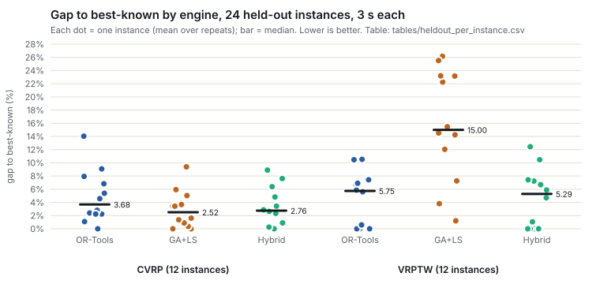
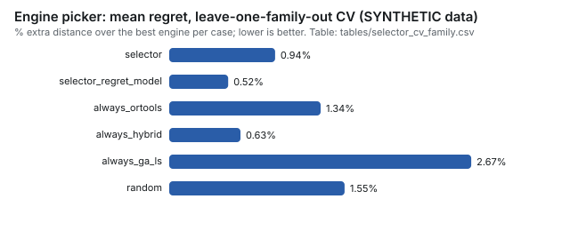

# LogiMind evaluation (P10)

Generated 2026-11-05 07:03 UTC by `experiments/p10_report.py` from **stored runs only**. Every number below comes from the committed
files under `experiments/results/`; nothing was typed in by hand. Machine for all runs: Rohit's laptop
(AMD64 Family 23 Model 96 Stepping 1, AuthenticAMD, 16 logical CPUs),
Python 3.14.7, OR-Tools 9.15.6755.
Tables are also in `docs/report/tables/` (CSV); figures in `docs/report/figures/` (SVG).

## 1. Solver quality

### 1.1 Held-out benchmark set (new runs, 5 Nov 2026)
- **Why a new set:** all 10 instances of the P3 comparison were also used in the P2 OR-Tools audit, which chose
  OR-Tools' default settings. Results on them favour OR-Tools. The 24 instances here were **not used for any tuning**:
  A-n33-k5, A-n37-k5, A-n39-k6, A-n45-k6, A-n48-k7, A-n53-k7, A-n55-k9, A-n63-k10, A-n69-k9, C102, C105, C202, C205, R102, R105, R110, R202, RC102, RC105, RC202, RC205, X-n106-k14, X-n110-k13, X-n120-k6.
- **Rules:** same instance, same distance matrix, same objective, same **total** wall-clock budget of 3 s per run
  (the hybrid's OR-Tools phase is inside it), one run at a time through the wall-clock guard, 3 repeats
  (OR-Tools has no seed, so its repeats are re-runs). Gaps are to the published best-known values in
  `experiments/benchmarks/bks.csv` (CVRPLIB, source URL and date in that file). 216 runs; estimate
  11 min.
- Engines are the three the platform serves: OR-Tools (audited defaults), GA + local search, and the hybrid
  (OR-Tools for half the budget, then GA + local search seeded with its tour).

| problem | budget_s | engine | instances | feasible | runs with violations | gap mean / median % | gap IQR % | gap range % | repeat SD (median, pp) | runtime mean / max s |
| --- | --- | --- | --- | --- | --- | --- | --- | --- | --- | --- |
| CVRP | 3.0 | GA + local search | 12 | 35 / 36 | 1 | 2.84 / 2.24 | 0.47 to 3.96 | 0.00 to 11.10 | 0.53 | 3.00 / 3.00 |
| CVRP | 3.0 | Hybrid (OR-Tools seed + GA + LS) | 12 | 36 / 36 | 0 | 3.53 / 2.42 | 1.20 to 5.89 | 0.00 to 12.39 | 0.60 | 3.00 / 3.00 |
| CVRP | 3.0 | OR-Tools | 12 | 36 / 36 | 0 | 4.88 / 3.68 | 2.24 to 7.11 | 0.00 to 14.05 | 0.00 | 3.00 / 3.00 |
| VRPTW | 3.0 | GA + local search | 12 | 36 / 36 | 0 | 15.74 / 15.11 | 10.34 to 23.23 | 0.00 to 28.40 | 1.45 | 3.00 / 3.01 |
| VRPTW | 3.0 | Hybrid (OR-Tools seed + GA + LS) | 12 | 36 / 36 | 0 | 4.66 / 5.75 | 0.00 to 7.29 | 0.00 to 13.22 | 0.00 | 3.01 / 3.01 |
| VRPTW | 3.0 | OR-Tools | 12 | 36 / 36 | 0 | 4.51 / 5.75 | 0.00 to 7.03 | 0.00 to 10.52 | 0.00 | 3.00 / 3.01 |

**Significance (paired over instances).** For each instance, the mean gap over feasible repeats; then a two-sided
Wilcoxon signed-rank test per pair, with a Holm correction over all 9 tests in this table. A difference
of at most 0.01 percentage points counts as a tie. An instance where one engine had no feasible run is left out of
that pair (column `dropped` in the CSV).

| set | scope | comparison (B minus A) | instances | median / mean diff (pp) | B better / tie / A better | Wilcoxon p | Holm-adjusted p |
| --- | --- | --- | --- | --- | --- | --- | --- |
| held-out, 3 s | all | GA + local search minus OR-Tools | 24 | 1.20 / 4.64 | 10 / 1 / 13 | 0.0680 | 0.2040 |
| held-out, 3 s | all | Hybrid (OR-Tools seed + GA + LS) minus OR-Tools | 24 | 0.00 / -0.60 | 10 / 10 / 4 | 0.0480 | 0.1920 |
| held-out, 3 s | all | Hybrid (OR-Tools seed + GA + LS) minus GA + local search | 24 | -0.79 / -5.24 | 14 / 1 / 9 | 0.0225 | 0.1127 |
| held-out, 3 s | CVRP | GA + local search minus OR-Tools | 12 | -1.70 / -1.96 | 10 / 1 / 1 | 0.0068 | 0.0479 |
| held-out, 3 s | CVRP | Hybrid (OR-Tools seed + GA + LS) minus OR-Tools | 12 | -1.20 / -1.35 | 9 / 2 / 1 | 0.0137 | 0.0820 |
| held-out, 3 s | CVRP | Hybrid (OR-Tools seed + GA + LS) minus GA + local search | 12 | 0.39 / 0.61 | 3 / 1 / 8 | 0.1475 | 0.2949 |
| held-out, 3 s | VRPTW | GA + local search minus OR-Tools | 12 | 8.20 / 11.23 | 0 / 0 / 12 | 0.0005 | 0.0044 |
| held-out, 3 s | VRPTW | Hybrid (OR-Tools seed + GA + LS) minus OR-Tools | 12 | 0.00 / 0.15 | 1 / 8 / 3 | 0.6250 | 0.6250 |
| held-out, 3 s | VRPTW | Hybrid (OR-Tools seed + GA + LS) minus GA + local search | 12 | -8.03 / -11.08 | 11 / 0 / 1 | 0.0010 | 0.0078 |

**Reading (from the tables above; "difference" = second engine minus first, negative = the second engine's gap
is smaller):**
- **CVRP, GA + LS vs OR-Tools:** GA + local search better on 10, tie 1, OR-Tools better on 1 of 12 instances; median difference -1.70 pp; Holm-adjusted p = 0.0479.
- **CVRP, hybrid vs OR-Tools:** Hybrid (OR-Tools seed + GA + LS) better on 9, tie 2, OR-Tools better on 1 of 12 instances; median difference -1.20 pp; Holm-adjusted p = 0.0820.
- **VRPTW, GA + LS vs OR-Tools:** GA + local search better on 0, tie 0, OR-Tools better on 12 of 12 instances; median difference 8.20 pp; Holm-adjusted p = 0.0044.
- **VRPTW, hybrid vs OR-Tools:** Hybrid (OR-Tools seed + GA + LS) better on 1, tie 8, OR-Tools better on 3 of 12 instances; median difference 0.00 pp; Holm-adjusted p = 0.6250.
- **All 24, hybrid vs OR-Tools:** Hybrid (OR-Tools seed + GA + LS) better on 10, tie 10, OR-Tools better on 4 of 24 instances; median difference 0.00 pp; Holm-adjusted p = 0.1920.
- Comparisons significant after the Holm correction (p < 0.05):
  - CVRP: GA + local search minus OR-Tools (Holm-adjusted p = 0.0479, median difference -1.70 pp)
  - VRPTW: GA + local search minus OR-Tools (Holm-adjusted p = 0.0044, median difference 8.20 pp)
  - VRPTW: Hybrid (OR-Tools seed + GA + LS) minus GA + local search (Holm-adjusted p = 0.0078, median difference -8.03 pp)
- **The hybrid is not significantly better than OR-Tools** at 3 s on CVRP, on VRPTW or over all 24 held-out
  instances (negative result, consistent with P3).

### 1.2 P3 comparison set (stored, 2 Nov 2026; tuning overlap)
The same three engines from the stored P3 runs (8 benchmark instances with a best-known value, 2 seeds, 3 s and
10 s). **These instances overlap the OR-Tools tuning set (P2 audit)**, so this table is biased towards OR-Tools
and is shown for completeness only.

| problem | budget_s | engine | instances | feasible | runs with violations | gap mean / median % | gap IQR % | gap range % | repeat SD (median, pp) | runtime mean / max s |
| --- | --- | --- | --- | --- | --- | --- | --- | --- | --- | --- |
| CVRP | 3.0 | GA + local search | 3 | 6 / 6 | 0 | 3.58 / 4.95 | 1.19 to 5.58 | 0.00 to 5.84 | 0.08 | 3.00 / 3.00 |
| CVRP | 3.0 | Hybrid (OR-Tools seed + GA + LS) | 3 | 6 / 6 | 0 | 3.46 / 4.92 | 1.19 to 5.31 | 0.00 to 5.53 | 0.32 | 3.00 / 3.00 |
| CVRP | 3.0 | OR-Tools | 3 | 6 / 6 | 0 | 3.88 / 5.79 | 1.45 to 5.83 | 0.00 to 5.85 | 0.00 | 3.00 / 3.00 |
| CVRP | 10.0 | GA + local search | 3 | 6 / 6 | 0 | 2.26 / 3.01 | 0.69 to 3.29 | 0.00 to 4.25 | 0.32 | 10.00 / 10.00 |
| CVRP | 10.0 | Hybrid (OR-Tools seed + GA + LS) | 3 | 6 / 6 | 0 | 2.44 / 3.18 | 0.61 to 4.06 | 0.00 to 4.16 | 0.04 | 10.00 / 10.00 |
| CVRP | 10.0 | OR-Tools | 3 | 6 / 6 | 0 | 3.07 / 3.52 | 0.88 to 5.14 | 0.00 to 5.68 | 0.00 | 10.00 / 10.00 |
| VRPTW | 3.0 | GA + local search | 5 | 10 / 10 | 0 | 13.89 / 12.53 | 6.69 to 21.89 | 0.00 to 26.80 | 1.41 | 3.00 / 3.01 |
| VRPTW | 3.0 | Hybrid (OR-Tools seed + GA + LS) | 5 | 10 / 10 | 0 | 3.54 / 3.33 | 2.91 to 4.78 | 0.00 to 6.67 | 0.00 | 3.01 / 3.01 |
| VRPTW | 3.0 | OR-Tools | 5 | 10 / 10 | 0 | 3.15 / 2.91 | 2.82 to 3.33 | 0.00 to 6.67 | 0.00 | 3.00 / 3.00 |
| VRPTW | 10.0 | GA + local search | 5 | 10 / 10 | 0 | 11.67 / 8.93 | 5.62 to 19.55 | 0.00 to 24.70 | 0.53 | 10.00 / 10.01 |
| VRPTW | 10.0 | Hybrid (OR-Tools seed + GA + LS) | 5 | 10 / 10 | 0 | 2.88 / 2.82 | 2.09 to 3.33 | 0.00 to 6.52 | 0.00 | 10.01 / 10.01 |
| VRPTW | 10.0 | OR-Tools | 5 | 10 / 10 | 0 | 2.61 / 2.72 | 2.52 to 3.74 | 0.00 to 4.26 | 0.00 | 10.00 / 10.00 |

| set | scope | comparison (B minus A) | instances | median / mean diff (pp) | B better / tie / A better | Wilcoxon p | Holm-adjusted p |
| --- | --- | --- | --- | --- | --- | --- | --- |
| P3 set, 3 s | all | GA + local search minus OR-Tools | 8 | 3.05 / 6.60 | 1 / 2 / 5 | 0.0625 | 0.5000 |
| P3 set, 3 s | all | Hybrid (OR-Tools seed + GA + LS) minus OR-Tools | 8 | 0.00 / 0.09 | 2 / 5 / 1 | 1.0000 | 1.0000 |
| P3 set, 3 s | all | Hybrid (OR-Tools seed + GA + LS) minus GA + local search | 8 | -3.05 / -6.52 | 6 / 1 / 1 | 0.0312 | 0.2812 |
| P3 set, 3 s | CVRP | GA + local search minus OR-Tools | 3 | 0.00 / -0.30 | 1 / 2 / 0 | 1.0000 | 1.0000 |
| P3 set, 3 s | CVRP | Hybrid (OR-Tools seed + GA + LS) minus OR-Tools | 3 | -0.55 / -0.42 | 2 / 1 / 0 | 0.5000 | 1.0000 |
| P3 set, 3 s | CVRP | Hybrid (OR-Tools seed + GA + LS) minus GA + local search | 3 | 0.00 / -0.12 | 1 / 1 / 1 | 1.0000 | 1.0000 |
| P3 set, 3 s | VRPTW | GA + local search minus OR-Tools | 5 | 9.19 / 10.74 | 0 / 0 / 5 | 0.0625 | 0.5000 |
| P3 set, 3 s | VRPTW | Hybrid (OR-Tools seed + GA + LS) minus OR-Tools | 5 | 0.00 / 0.39 | 0 / 4 / 1 | 1.0000 | 1.0000 |
| P3 set, 3 s | VRPTW | Hybrid (OR-Tools seed + GA + LS) minus GA + local search | 5 | -9.19 / -10.35 | 5 / 0 / 0 | 0.0625 | 0.5000 |
| P3 set, 10 s | all | GA + local search minus OR-Tools | 8 | 1.64 / 5.36 | 2 / 2 / 4 | 0.1562 | 1.0000 |
| P3 set, 10 s | all | Hybrid (OR-Tools seed + GA + LS) minus OR-Tools | 8 | -0.17 / -0.07 | 4 / 2 / 2 | 0.8438 | 1.0000 |
| P3 set, 10 s | all | Hybrid (OR-Tools seed + GA + LS) minus GA + local search | 8 | -1.83 / -5.43 | 4 / 2 / 2 | 0.1562 | 1.0000 |
| P3 set, 10 s | CVRP | GA + local search minus OR-Tools | 3 | -0.51 / -0.81 | 2 / 1 / 0 | 0.5000 | 1.0000 |
| P3 set, 10 s | CVRP | Hybrid (OR-Tools seed + GA + LS) minus OR-Tools | 3 | -0.34 / -0.63 | 2 / 1 / 0 | 0.5000 | 1.0000 |
| P3 set, 10 s | CVRP | Hybrid (OR-Tools seed + GA + LS) minus GA + local search | 3 | 0.17 / 0.18 | 0 / 1 / 2 | 0.5000 | 1.0000 |
| P3 set, 10 s | VRPTW | GA + local search minus OR-Tools | 5 | 6.20 / 9.06 | 0 / 1 / 4 | 0.1250 | 1.0000 |
| P3 set, 10 s | VRPTW | Hybrid (OR-Tools seed + GA + LS) minus OR-Tools | 5 | 0.00 / 0.27 | 2 / 1 / 2 | 0.8750 | 1.0000 |
| P3 set, 10 s | VRPTW | Hybrid (OR-Tools seed + GA + LS) minus GA + local search | 5 | -5.59 / -8.79 | 4 / 1 / 0 | 0.1250 | 1.0000 |

### 1.3 Constraint violations
The validator checks every returned plan. "Runs with violations" above counts runs with any capacity, time-window,
unserved-customer or other violation (for example more routes than vehicles); such a plan is never shown as
feasible. Infeasible runs on the held-out set:

- A-n45-k6, GA + local search, seed 1, 3 s: status `solved`, other violations 1; vehicles used 7 of 6.

## 2. Engine picker (selector), stored 4 Nov 2026, SYNTHETIC data
324 runs on 108 synthetic cases (generator in `backend/app/selector/generator.py`).
Leave-one-family-out cross-validation; regret = % extra distance over the best engine of the case.

| strategy | accuracy | mean_regret_pct | max_regret_pct | failed_choices |
| --- | --- | --- | --- | --- |
| selector | 0.472 | 0.94 | 7.27 | 0.0 |
| selector_regret_model | 0.426 | 0.52 | 5.87 | 0.0 |
| always_ortools | 0.565 | 1.34 | 11.75 | 0.0 |
| always_hybrid | 0.213 | 0.63 | 8.67 | 0.0 |
| always_ga_ls | 0.222 | 2.67 | 25.96 | 0.0 |
| oracle | 1.000 | 0.00 | 0.00 | 0.0 |
| random | 0.330 | 1.55 | - | 0.0 |

**Reading:** the served regret model has the lowest mean regret in this CV, but always choosing the hybrid is close,
and in the leave-one-size-out CV (see `experiments/results/selector_2026-11-04/evaluation.md`) always-hybrid is
better. **The picker is not a proven improvement over always using the hybrid** (negative result, also in
`docs/model_card_selector.md`). The data are synthetic; nothing here is measured on real fleets.

## 3. Replanning, stored 4 Nov 2026, SYNTHETIC data
6 synthetic instances (40 customers), one seed; the first third of each route frozen. Feasible = validator **and**
the independent frozen-stop check.

| engine | event | budget_s | warm | feasible | frozen_violations | mean distance | time to feasible, mean / max s |
| --- | --- | --- | --- | --- | --- | --- | --- |
| ga | urgent_order_predispatch | 0.5 | cold | 6 / 6 | 0 | 664.15 | 0.50 / 0.50 |
| ga | urgent_order_predispatch | 0.5 | warm | 6 / 6 | 0 | 650.11 | 0.50 / 0.50 |
| ga | urgent_order_predispatch | 2.0 | cold | 6 / 6 | 0 | 639.60 | 2.00 / 2.00 |
| ga | urgent_order_predispatch | 2.0 | warm | 6 / 6 | 0 | 636.49 | 2.00 / 2.00 |
| ortools | failed_delivery | 0.5 | cold | 6 / 6 | 0 | 683.44 | 0.50 / 0.51 |
| ortools | failed_delivery | 0.5 | warm | 6 / 6 | 0 | 649.61 | 0.50 / 0.51 |
| ortools | failed_delivery | 2.0 | cold | 6 / 6 | 0 | 651.05 | 2.00 / 2.01 |
| ortools | failed_delivery | 2.0 | warm | 6 / 6 | 0 | 647.74 | 1.71 / 2.01 |
| ortools | urgent_order | 0.5 | cold | 6 / 6 | 0 | 703.29 | 0.50 / 0.51 |
| ortools | urgent_order | 0.5 | warm | 6 / 6 | 0 | 662.84 | 0.50 / 0.51 |
| ortools | urgent_order | 2.0 | cold | 6 / 6 | 0 | 673.82 | 1.84 / 2.01 |
| ortools | urgent_order | 2.0 | warm | 6 / 6 | 0 | 660.13 | 2.00 / 2.01 |
| ortools | vehicle_breakdown | 0.5 | cold | 6 / 6 | 0 | 748.07 | 0.50 / 0.51 |
| ortools | vehicle_breakdown | 0.5 | warm | 6 / 6 | 0 | 729.38 | 0.51 / 0.51 |
| ortools | vehicle_breakdown | 2.0 | cold | 6 / 6 | 0 | 712.08 | 2.01 / 2.01 |
| ortools | vehicle_breakdown | 2.0 | warm | 6 / 6 | 0 | 714.29 | 2.01 / 2.01 |

**Reading:** every replan was feasible with 0 frozen-stop violations. Time to a feasible plan is about the budget,
because the engines use their whole budget. Warm vs cold distances, including the negative result for
breakdowns at 2 s, are in `experiments/results/replan_2026-11-04/report.md`.

## 4. Copilot
- **Real model: NOT RUN.** Ollama is not installed on this laptop (checked 5 Nov 2026), and the evaluation set is
  still a DRAFT (50 instructions in `docs/eval/copilot_instructions_DRAFT.json`) waiting for the team to
  review and freeze it. There are **no accuracy numbers**, and none may be quoted.
- What exists: 16 backend tests with the deterministic fake LLM. They check behaviour (schema-constrained intents,
  no route fields, grounding check, clarify / confirm / refuse paths), not language understanding.

## 5. Road matrix (P4)
Not part of the solver comparison above (benchmarks use their own distances). Tested offline only, with real OSRM
answers for 6 synthetic points; never run against a self-hosted OSRM (decision 0019).

## Threats to validity
- One laptop; wall-clock budgets depend on the machine. All runs were one at a time.
- 3 s budgets only on the held-out set (compute cap of 25 min for this session); 10 s results exist only on the
  biased P3 set.
- 24 held-out instances, 12 per problem type: per-type tests have little power, so "no significant difference" is
  not evidence of equality.
- The hybrid's 50/50 split is untuned (P3 note).
